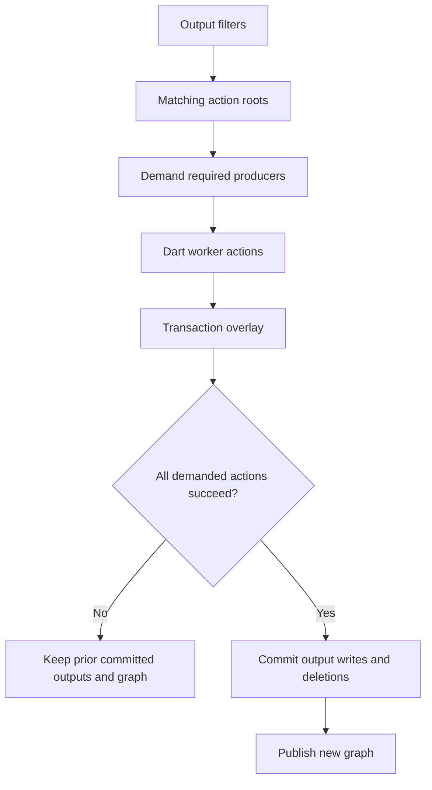

# ADR 0032: Native build-filter demand and output state

- Status: Accepted
- Date: 2026-10-10
- Amends ADR 0029 and ADR 0031; extends the private state contract in ADR 0030.
- Amended by [ADR 0033](0033-filtered-demand-scheduler.md): filtered roots use
  shared parallel demand coordination and deferred workers.

## Context and decision

Stock build_runner selects actions by declared outputs, then demands producers
as generated inputs are read. A selected action may write every declared
output, so filtering follows the phase-aware graph and output lifecycle.

## Reuse and demand

- Check ordered stock inputs, resolver dependencies, and full actual glob membership; byte equality alone cannot prove a glob unchanged.
- Asset listings follow stock order: plain sources, then earlier-phase generated outputs, with Dart asset-ID order within each group.
- A producer runs once and handles all declared outputs. Reuse hides ungenerated siblings; old state without ordered-input or glob evidence falls back to stock.

## Source evidence and watch

- Watch subscribes after plan validation and before the first build. Successful native builds retain build-start evidence for existing sources through commit, so edits or deletions during actions remain visible to the next cycle.
- A filtered build's first worker `read` or `canRead` of an eligible external source absent from the snapshot keeps its first observed bytes or missing result and graph evidence; a post-build scan cannot replace it. Generated assets are excluded.
- Large observations use a temporary spool: Unix requests mode 0600, Windows inherits the temp-directory ACL, and abrupt exit can leave an orphan.

## Output state and deletion

- Only evaluated actions enter successful incremental state. Unselected outputs may remain temporarily, then conflict and be deleted on a later build or watch restart; filters do not preserve files.
- Deletion uses the prior graph's recorded output location, not filesystem existence. A location transition needs recorded location plus proven stock-plan compatibility.
- Input deletion removes outputs through the graph. Removed builder apps, dependency-package conflicts, or transitions without compatibility evidence fall back before native actions.

## Failure and commit boundary

- A demanded producer failure fails the invocation even if a consumer catches its read or `canRead` error.
- If an action fails, native applies no pending outputs or graph changes and retains the previous successful state; stock may already have changed files.
- This is all-success commit behavior, not crash atomicity: interruption or I/O failure during writes/deletions can leave partial files with the old graph; no rollback journal exists.

## Supported boundary

| Request | `auto` | `rust` |
| --- | --- | --- |
| Supported syntax and compatible builders with declared outputs | Native | Native |
| Unsupported syntax, builder combination, or prior-state transition | Stock for the whole invocation | Error before actions |

Dart mode always uses stock. Filters are build/watch-only; prewarm rejects
them. Native supports repeated or comma-separated OR filters, root-relative
paths, `package:` paths under `lib`, `asset:` paths under the package root,
`*`, and whole-segment `**`. Unsupported patterns and optional, post-process,
zero-output, or trigger-only builders use stock in auto and error in rust;
recorded cyclic resolver graphs also use stock for incremental reuse.
See the [launcher reference](../launcher-and-release.md) for CLI and mode
behavior, and the [configuration guide](../configuration.md) for config
transitions.

## Evidence

Native supports build_runner `>=2.16.2 <2.17.0`; comparisons use stock 2.16.2.
The pinned upstream evidence is in `build_plan/build_filter.dart`,
`build/build.dart`, `build/build_series.dart`, and
`build_plan/build_plan.dart`; these are implementation sources, not stable API.

`scripts/correctness_build_filter.sh` compares bytes, existence/deletion,
exit status, builder history, incremental transitions, and watch behavior.
Implementation details: [filtered evaluator](../../rust/src/build/filtered.rs),
[commit path](../../rust/src/build/commit.rs), and [protocol v1](../../protocol/v1.md).
