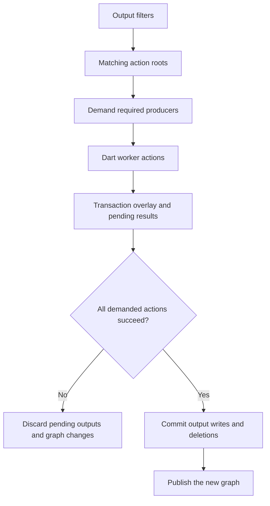

# ADR 0032: Native build-filter demand and output state

- Status: Accepted
- Date: 2026-10-10
- Amends ADR 0029 and ADR 0031; extends the private state contract in ADR 0030.

## Context

Stock build_runner 2.16.2 selects steps whose declared outputs match a filter,
then demands generated inputs as those steps read them. It does not limit a
selected step to only the matched output. Deletion also depends on the last
successful build state and whether outputs belong in the source or artifact
tree. Path-only selection cannot preserve these rules.

## Decision

Keep the full phase-aware action graph. Filters choose roots; the worker
recursively demands required producers. An action runs once per build and may
write all its declared outputs.

### Reuse evidence

A prior action is reusable only when its recorded inputs still match:

- Ordered stock inputs, resolver dependencies, and actual glob membership are
  checked against the current build.
- Listing order matches stock: plain sources first, then earlier-phase
  generated outputs, with Dart asset-ID ordering within each group.
- Shared producers execute once. Reused actions hide declared sibling outputs
  they did not actually generate, so stray files cannot satisfy a dependency.

Stock input order and complete glob membership are required evidence for
filtered reuse. Older graph state without that evidence can still serve ordinary
builds, but filtered builds fall back to stock.

### Source reads and watch

Native watch starts listening after plan validation and before the initial
build. Events arriving during that build stay queued for the next cycle.

The build-start snapshot is authoritative for sources it contains. If a worker's
first read or canRead observes an eligible external source absent from that
snapshot, native keeps that first byte or missing result through the transaction
and records the matching source evidence. A post-build scan cannot overwrite
it, so a later edit remains visible to the queued watch cycle. Generated assets
and declared outputs do not use this rule.

### Output state and deletion

Only evaluated actions enter the successful incremental state. An unselected
output may remain on disk for the current filtered build, then be treated as a
conflict and removed on a later build or watch restart. Filters are runtime
demand and do not change manifest or configuration identity; do not rely on
them to preserve generated files.

Deletion uses recorded output locations, not path existence. When a supported
source/cache transition changes output location, native uses the previous
location to remove stale files. Stock 2.16.2 includes
`outputsToArtifactTree` in `InBuildPhase.identity`, which supplies evidence
that the prior plan is incompatible. If a deleted input removes an action, the
ordinary graph deletion path removes its recorded outputs. Conflicts in a
dependency package, removed prior builder applications, or transitions without
compatible prior-state evidence route to stock before native actions.

### Failure and commit boundary

A demanded producer failure fails the invocation even if its consumer catches
a read or canRead error. Native publishes neither pending outputs nor graph
changes when an action fails; stock may already have written or removed files.

This is an all-actions-success boundary, not crash atomicity. During commit,
output writes and deletions happen before graph publication. Interruption or I/O
failure can therefore leave partial files with the previous graph; there is no
rollback journal.

### Supported boundary

| Request | auto | rust |
| --- | --- | --- |
| Supported filter syntax and compatible normal builders | Native | Native |
| Unsupported syntax, builder combination, or prior-state transition | Stock for the whole invocation | Error before actions |
| Filtered build/watch in dart mode | Stock build_runner | Stock build_runner |
| Prewarm with a build filter | Error; prewarm has no filter mode | Error before actions |

Native accepts repeated or comma-separated filters (OR), root-relative paths,
package: paths relative to lib, and asset: paths relative to the package root.
Package names may contain *; path globs support * and whole-segment **.
Queries, fragments, percent encoding, escapes, non-ASCII, classes, braces, ?,
absolute paths, and dot segments use stock. Optional, post-process, zero-output
and trigger-only builders, and recorded cyclic resolver reuse also use stock.
See the [launcher reference](../launcher-and-release.md) for CLI routing and
[configuration guide](../configuration.md) for config transitions.

### Evidence and consequences

The behavior is measured against stock build_runner 2.16.2:
`build_plan/build_filter.dart`, `build_runner_command_line.dart`,
`build/build.dart`, `build/build_series.dart`, and
`build_plan/build_plan.dart` (incremental plan compatibility and deletion).
These are version-pinned implementation sources, not a stable public API.

`scripts/correctness_build_filter.sh` compares output bytes, existence and
deletion, exit status, builder history, incremental transitions, and watch
behavior. Unsupported combinations are compared through stock fallback and
strict-mode rejection.

Filtered roots and recursive demands currently run serially on one resident
worker, even when --jobs is higher. The normal unfiltered scheduler is
unchanged. Implementation details live in the
[filtered evaluator](../../rust/src/build/filtered.rs),
[worker request contract](../../rust/src/worker/request.rs), and
[protocol v1](../../protocol/v1.md).
