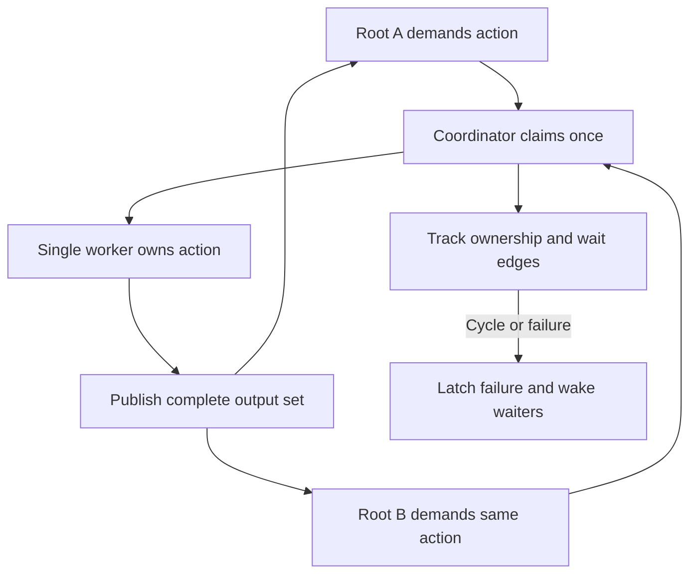

# ADR 0033: Parallel filtered demand and lazy worker startup

- Status: Accepted
- Date: 2026-10-11
- Amends [ADR 0032](0032-native-build-filter-demand-and-output-state.md).

## Context

Filtered builds ran serially and started a Dart worker even when every action
could be reused. Independent dirty roots can overlap, but dependencies arrive
through live worker requests and shared producers must have one consistent result.

## Decision

Probe reuse before execution. The probe uses the same primary-input, ordered
stock-input, glob, and resolver evidence as the worker path. Only dirty roots
enter the worker pool.

| Build state | Worker policy |
| --- | --- |
| No demanded changes | Zero artifact resolutions, worker starts, or initializations |
| Dirty roots, default | One worker |
| Explicit --jobs N | Up to N workers, capped by dirty-root count, when the shared analyzer byte store is enabled |
| Shared analyzer byte store disabled | One worker, even when --jobs is set |
| Unfiltered build | Existing machine-based default |

The one-worker default is fixed and conservative for lightweight builders.
Filtered watch defers pool startup until a dirty root needs work; ordinary watch
startup is unchanged. BUILD_RUNNER_ACCELERATOR_RESOLVER_CAP applies only to
unfiltered resolver-backed batches.

### Action ownership

The coordinator grants one worker each action claim and publishes one immutable
record for all declared outputs. Every waiter applies the complete output set
to its overlay before continuing.

A record distinguishes generated bytes, missing siblings, and files already on
disk. The wait graph includes nested ownership and cross-worker waits. Cycles,
action or IPC errors, panics, and owner drops fail the transaction and wake
all waiters. Locks protect coordinator memory only; no IPC or filesystem work
runs while holding them.

### Demand and reuse

- Live read, canRead, findAssets, and resolver requests discover dependencies;
  the previous graph is reuse evidence, not the complete future dependency list.
- If a reused candidate reaches dirty work through a new dependency, the probe
  keeps its parent dirty. The worker may reuse it after checking the completed
  dependency's inputs and glob membership.
- Filtered resolve_assets prefetch remains refused; generated assets are
  demanded after their producer completes. Optional, post-process,
  trigger-only, and zero-output boundaries remain in ADR 0032.

### Watch and commit

- Each cycle uses its starting source/glob evidence; generated outputs use the
  post-commit snapshot. Events during a build remain queued for the next cycle.
- Workers share the first observed bytes for an external source absent from the
  snapshot, matching stock source caching. This adds a cold read and digest.
- Outputs and graph publish only after all roots and recursive demands succeed.
  A builder or worker failure retains the previous successful state; commit
  interruption or I/O failure can leave partial files. See ADR 0032 and ADR 0002.

## Consequences

Independent dirty roots can overlap; nested work within one root stays on its
worker. More workers add process startup and Analyzer memory, so short tasks may
slow down. Use explicit --jobs when measurements show a benefit. Disabling the
shared byte store forces one filtered worker because resolver state may be
process-local. The stock fallback and unfiltered scheduler are unchanged.

See the [launcher reference](../launcher-and-release.md) for the option
contract and [filtered evaluator](../../rust/src/build/filtered.rs) for
implementation details.
