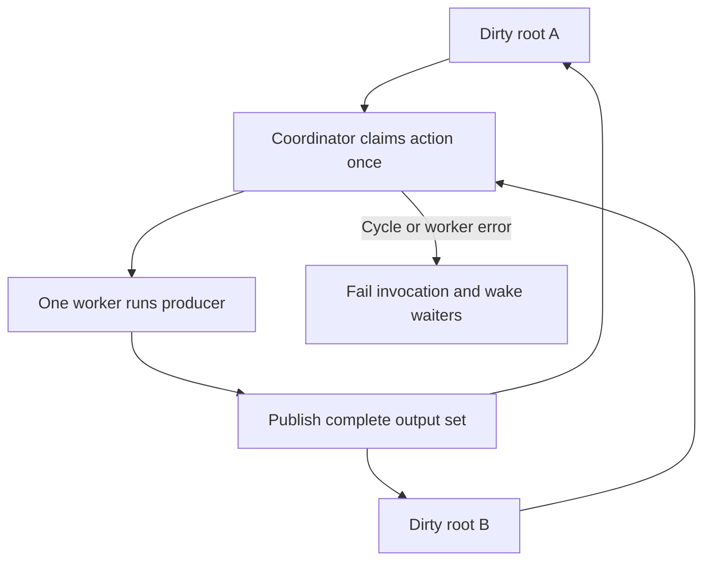

# ADR 0033: Parallel filtered demand and lazy worker startup

- Status: Accepted
- Date: 2026-10-11
- Amends [ADR 0032](0032-native-build-filter-demand-and-output-state.md).

## Context and decision

Filtered builds now start workers only for dirty roots. Independent roots can
run in parallel, while a shared producer must execute once and provide the same
complete output set to every root that needs it.

| Build state | Worker policy |
| --- | --- |
| No demanded changes | No artifact resolution, worker start, or initialization |
| Dirty roots, default | One worker |
| Explicit `--jobs N` | Up to N workers, capped by dirty-root count, when the shared byte store is enabled |
| `BUILD_RUNNER_ACCELERATOR_BYTE_STORE=0` | One worker, even when `--jobs` is set |
| Unfiltered build | Existing machine-based default |

The one-worker default suits lightweight builders. Filtered watch starts its
pool when a dirty root needs work; ordinary watch startup is unchanged.

## Action ownership

- The coordinator assigns each producer action to one worker; that producer runs once.
- The worker publishes the action's complete declared output set to every waiting root.
- A wait cycle, action or IPC error, panic, or worker exit fails the invocation and wakes all waiters.
- Output and graph publication still require all demanded roots to succeed; see ADR 0032 for failure and watch boundaries.

## Limits and consequences

Parallelism is across independent dirty roots; dependency work for a root stays
on its worker, and shared producers have one owner. More workers add process
startup and Analyzer memory, so short or lightweight tasks may run slower. Use
explicit `--jobs` when measurements show a benefit. Disabling the shared byte
store forces one filtered worker because resolver state may be process-local.
The stock fallback and unfiltered scheduler are unchanged.

See [ADR 0032](0032-native-build-filter-demand-and-output-state.md) for source,
watch, and commit behavior, and the [filtered evaluator](../../rust/src/build/filtered.rs)
for implementation details.
